# Duchamp Essential

Duchamp Essential is a native hardware-control application for Xiaomi Duchamp
(POCO X6 Pro / Redmi K70E) and its MediaTek Dimensity 8300-Ultra platform.

> Duchamp port of [Rodin Essential](https://github.com/NEESCHAL-3/Rodin-Essential) by NEESCHAL-3, rebranded for SaanOS.
It combines an Android `NativeActivity`, a Flutter AOT interface, a Rust host
runtime, and a separately privileged Rust daemon. The UI and hardware-control
logic remain native/AOT. A small, framework-only DEX adapter provides the
Quick Settings bypass tile and Android predictive Back callbacks; it contains
no AndroidX, Compose or third-party managed libraries.

The APK never runs as root, does not use the system UID, and does not request
privileged Android permissions. Kernel and vendor controls are owned by the
daemon and reached through authenticated local transports restricted to the
installed application UID.

## Supported target

- Device codename: `duchamp`
- SoC: MediaTek MT6897 / Dimensity 8300-Ultra
- CPU: 4× Cortex-A510 + 4× Cortex-A715 (4+3+1 policies), up to 3.35 GHz
- GPU: Mali-G615 MC6, 6 cores, up to 1400 MHz
- ABI: ARM64
- Android: API 31 or newer
- Kernel userspace: 16 KB page-compatible native binaries
- Vendor dependencies: Goodix non-THP/THP touch, supported Xiaomi display services and MediaTek GED

This is device-specific software. Other devices are rejected by the root-module
installer and are not supported by this module.

## Main features

- Four persistent GPU performance profiles with live hardware readback.
- Mali devfreq range, governor, GED boost, power-policy, and OPP controls.
- CPU core mask, independent cluster governors, and validated per-cluster
  minimum/maximum or sustained exact-lock controls sourced from the live kernel
  OPP table.
- UFS scheduler selection across every detected UFS logical unit.
- Touch profiles for 240 Hz native timing, 480 Hz native timing, and the
  original v1.18.0 one-millisecond Android output stream generated from the
  native 480 Hz source.
- Xiaomi touch/display AIDL integration, color modes, expert calibration,
  sunlight mode, HDR/video controls, resolution, and density controls.
- ZRAM size, algorithm, swappiness, compaction, and power telemetry.
- Charging target tiers of 25/33/45/55/67 W using the global Duchamp FCC ceiling.
  Actual power follows charger negotiation, temperature and battery taper.
  Existing 65/85/90 W selections migrate to the 67 W tier.
- Goodix non-THP touch control through the driver report-rate latch, without
  requiring a THP HAL memory mapping.
- Kernel-supported bypass charging with Immediate or 20/40/80/90% thresholds,
  daemon-owned persistence and measured battery-flow reporting.
- Whole-app hardware-control pause and reset, plus OEM Control defaults for
  touch response and display colour/temperature.
- [System Colors](docs/SYSTEM_COLORS.md): Android Material You seed palettes,
  wallpaper reset, style previews, and capability-based native color readback
  without a HyperOS, ColorOS, or AOSP ROM-name allowlist.
- Daemon-owned persistence and background reassertion after boot, screen wake,
  vendor resets, app force-close, or removal from recents.
- Configurable in-app motion timing with native 120 Hz frame pacing.
- [Per-App Controls](docs/PER_APP_CONTROLS_IMPLEMENTATION.md): foreground touch,
  refresh-rate, CPU and GPU overrides, with saved profiles and global/ROM
  restoration. Starts disabled; system apps are hidden by default.
- [Memory DVFS & UFS](docs/MEMORY_STORAGE_TRIALS.md): supported dynamic ranges,
  exact driver-policy requests and OEM Reset. These are session controls,
  recovered to originals after daemon restart or reboot.
- Bypass Charging Quick Settings/Control Center tile with direct access to
  Charging Control on long-press.

## Screenshots

Screenshots from Duchamp Essential running on the device.

<table>
  <tr>
    <td align="center"><a href="docs/screenshots/home.png">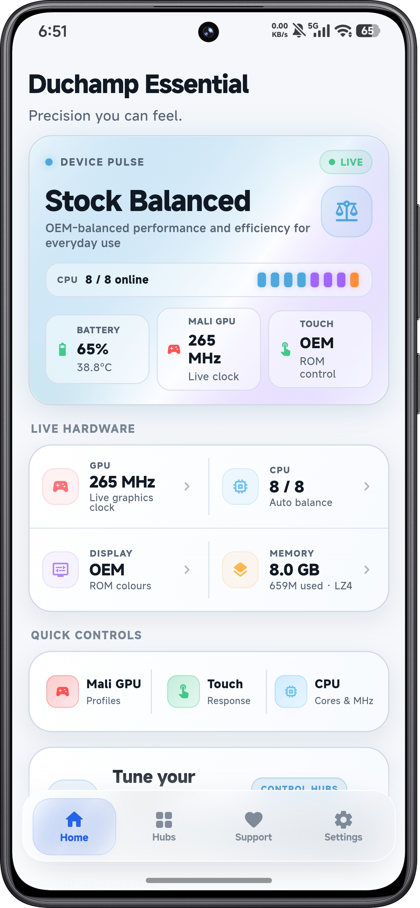</a><br>Home</td>
    <td align="center"><a href="docs/screenshots/control-hubs.png">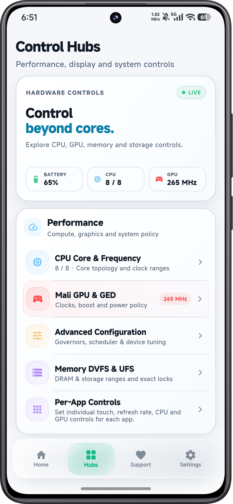</a><br>Control Hubs</td>
    <td align="center"><a href="docs/screenshots/cpu.png">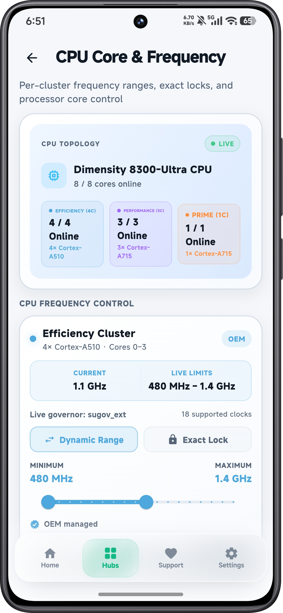</a><br>CPU</td>
    <td align="center"><a href="docs/screenshots/gpu.png">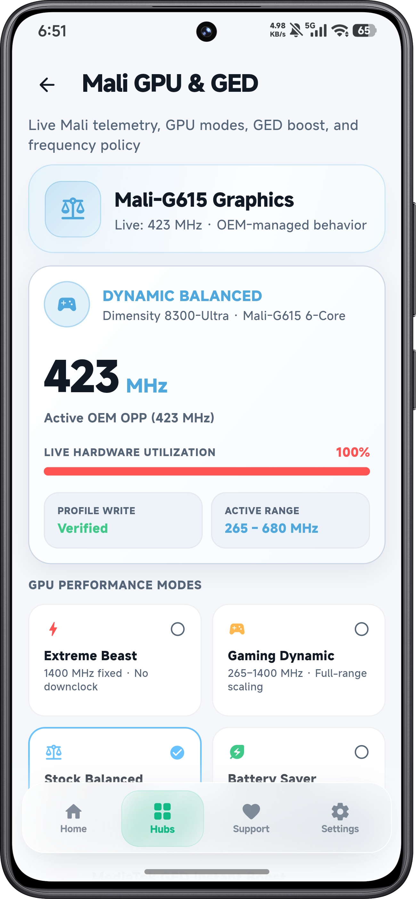</a><br>GPU</td>
  </tr>
  <tr>
    <td align="center"><a href="docs/screenshots/touch.png">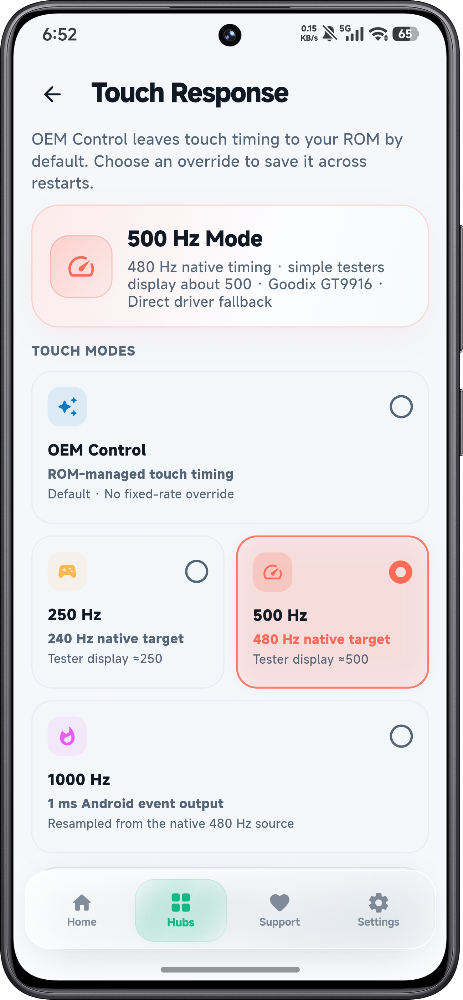</a><br>Touch</td>
    <td align="center"><a href="docs/screenshots/display.png">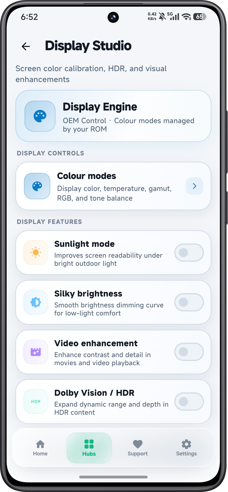</a><br>Display</td>
    <td align="center"><a href="docs/screenshots/charging.png">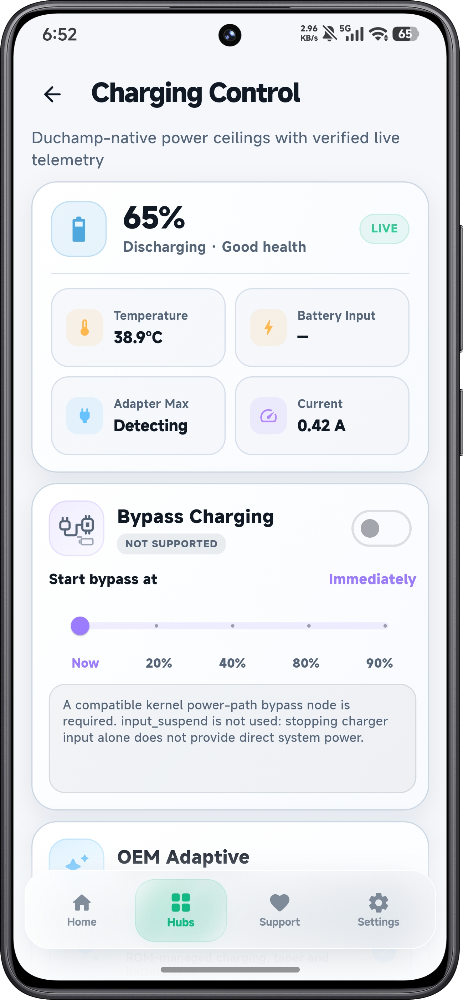</a><br>Charging</td>
    <td align="center"><a href="docs/screenshots/zram.png">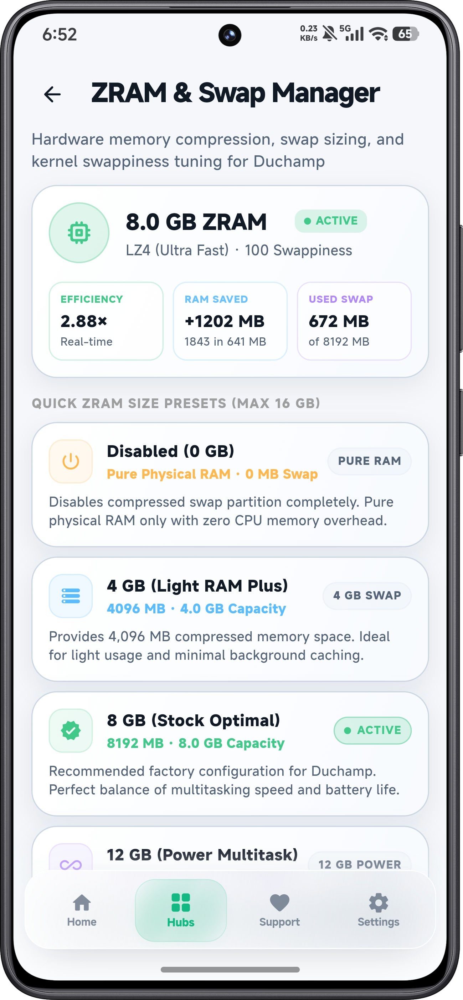</a><br>zRAM</td>
  </tr>
  <tr>
    <td align="center"><a href="docs/screenshots/support.png">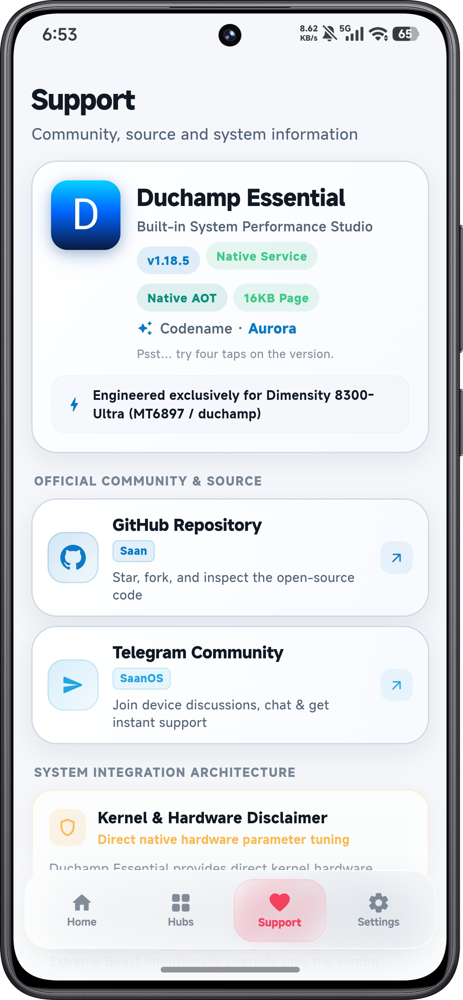</a><br>Support</td>
    <td align="center"><a href="docs/screenshots/system-colors.png">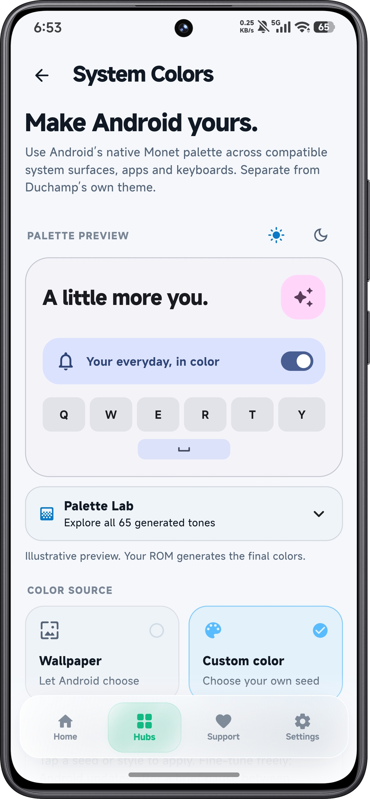</a><br>System Colors</td>
    <td align="center"><a href="docs/screenshots/advanced-configuration.png">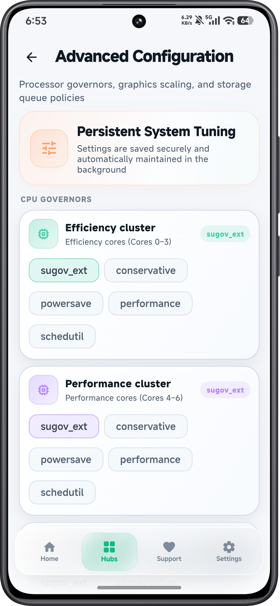</a><br>Advanced Configuration</td>
  </tr>
</table>

## Performance profiles

| Profile | GPU range and governor | GED / power policy | CPU behavior |
| --- | --- | --- | --- |
| Stock Balanced | Vendor-managed 265–1400 MHz, `dummy` | GED off, `coarse_demand` | Unchanged; controlled separately |
| Gaming Dynamic | 265–1400 MHz, `simple_ondemand` | GED on, `always_on` | Unchanged; controlled separately |
| Battery Saver | 265–601 MHz, `powersave` | GED off, `coarse_demand` | Unchanged; controlled separately |
| Extreme Beast | Fixed 1400 MHz, `performance`, DVFS off | GED on, `always_on` | Unchanged; controlled separately |

GPU profiles never modify CPU governors, CPU clock ranges, or CPU core state.
Vendor CPU and platform thermal services remain running in every mode. Gaming
Dynamic and Extreme Beast override the Mali cooling constraint and can still
cause extreme heat, rapid battery drain, instability, or an emergency hardware
shutdown.

Custom CPU ranges remain separate from GPU profiles and governors. While at
least one custom CPU range is active, the daemon selects Duchamp's OEM
`thermal-nolimits` configuration so Xiaomi's userspace policy cannot replace an
exact lock with a lower ceiling. It keeps the thermal services alive, remembers
the configuration that was active beforehand, and restores it when the final
custom CPU range is reset.

## Installation

Install the module ZIP through KernelSU Next Manager or Magisk while Android is
running, reboot, and enable Duchamp Essential. The bundled APK is an ordinary
user app; the privileged backend runs in the module daemon. A standalone APK
does not provide hardware control. Recovery installation is not supported.

## Build from source

Required tools:

- Linux host
- Flutter SDK and revision-matched Flutter engine checkout
- Rust toolchain with `aarch64-linux-android`
- Android SDK, platform 36, build-tools, and NDK r27 or newer
- JDK 17 or newer, `ninja`, `zip`, `unzip`, and standard ELF tools

Build the pinned engine once:

```bash
rustup target add aarch64-linux-android
./tools/build-flutter-engine.sh
```

Build without touching a connected device:

```bash
DUCHAMP_BUILD_ONLY=1 ./build-and-install.sh
```

Output is written under `out/release/<timestamp>/`. The build verifies
Flutter analysis, ARM64 AOT output, the restricted platform DEX adapter, APK signing, 16 KB ZIP alignment,
16 KB ELF segment alignment, and a content stamp covering the packaged Flutter
assets and ICU data. If no signing key is supplied, a stable development key is
created once under the ignored `out/signing/` directory and reused by later
local builds.

For release signing, set:

```bash
DUCHAMP_KEYSTORE=/absolute/path/release.jks \
DUCHAMP_KEY_ALIAS=release \
DUCHAMP_KEYSTORE_PASS='store-password' \
DUCHAMP_KEY_PASS='key-password' \
DUCHAMP_BUILD_ONLY=1 ./build-and-install.sh
```

## KernelSU Next and Magisk module

For an existing rooted ROM, build the combined application and daemon module:

```bash
DUCHAMP_KEYSTORE=/absolute/path/release.jks \
DUCHAMP_KEY_ALIAS=release \
DUCHAMP_KEYSTORE_PASS='store-password' \
DUCHAMP_KEY_PASS='key-password' \
  ./tools/build-kernelsu-next-module.sh
```

Install the ZIP from KernelSU Next Manager or the Magisk app while Android is
running. The installer registers the bundled APK as an ordinary user app and
the module runs only the separate hardware daemon as root. No live SELinux
patch, system overlay, privileged-app conversion, or app-to-root socket rule is
used. The direct Unix transport uses `SO_PEERCRED`. ROMs that block cross-domain
Unix `connectto` use a root-privileged localhost port instead; the app first
proves from its own UID/SELinux context that low-port binding is denied, and the
daemon resolves the accepted client's UID from `/proc/net/tcp` before serving a
command. A daemon-initiated Unix path remains as a compatibility fallback.
Module Action reports which authenticated transport completed instead of
treating a root-only control-client ping as proof. The package uses `skip_mount`;
because it overlays no partition files, KernelSU does not require a metamodule.
Recovery installation is not supported.

Keep the signing key for every future module update. Android rejects an APK
update signed by a different certificate. The first release after the signing
identity reset includes a one-time migration for module installations: it tries
a normal update first and only removes/reinstalls the user application when
Android reports a certificate mismatch. Hardware profiles stored under
`/data/adb/duchamp-essential` remain intact, while application-local preferences
reset once. Later releases signed by the retained key update normally.

## Repository layout

```text
android/
  kernelsu-next/        KernelSU Next and Magisk module source
  package/              Manifest and Android resources
  platform/             Minimal Android tile and Back callback adapters
docs/                   Architecture and build documentation
runtime/
  daemon-rust/          Privileged hardware backend and control client
  flutter-engine/       Embedder header and ignored pinned engine prebuilts
  host-rust/            NativeActivity, Flutter embedder, JNI, and IPC bridge
tools/                  Engine and module build scripts
ui/flutter/             Flutter AOT interface
```

## Documentation

- [Architecture](docs/ARCHITECTURE.md)
- [Building and verification](docs/BUILDING.md)
- [Flutter runtime pin](docs/FLUTTER_RUNTIME.md)
- [Commit convention](docs/COMMITS.md)

## License

Licensed under the Apache License, Version 2.0. See [LICENSE](LICENSE).
